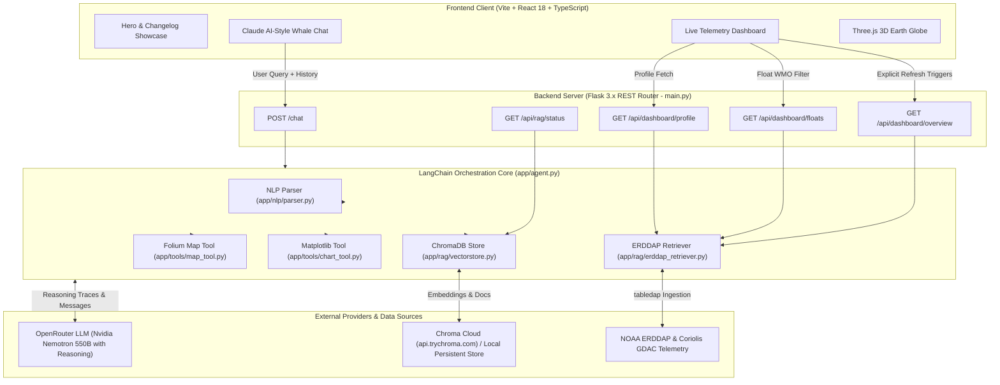
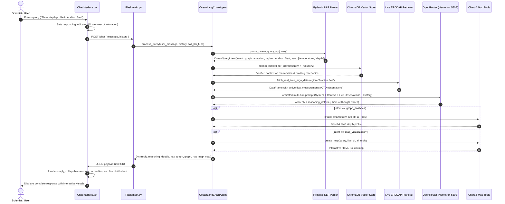
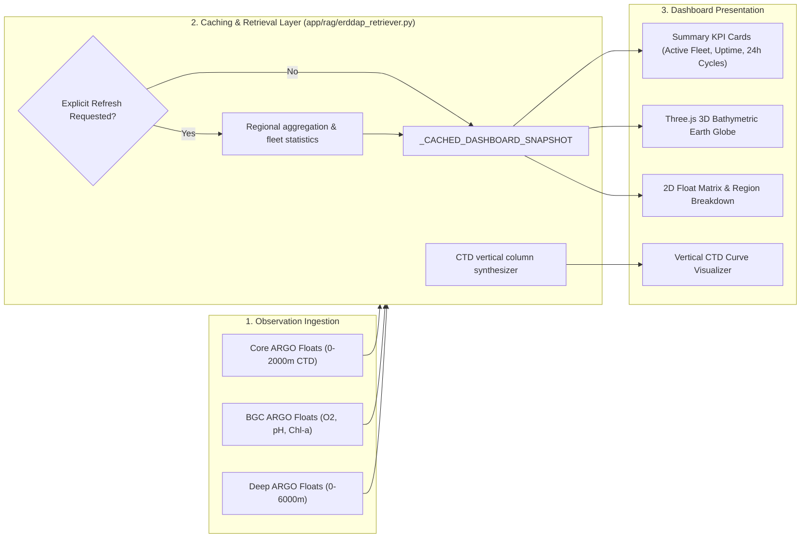

# 🌊 ARGO-AI: Autonomous Oceanographic Intelligence & Real-Time Float Analytics

[](https://opensource.org/licenses/MIT)
[](https://python.org)
[](https://react.dev)
[](https://www.typescriptlang.org/)
[](https://langchain.com)
[](https://www.trychroma.com/)
[](https://vitejs.dev)

**ARGO-AI** is a full-stack, enterprise-grade oceanographic intelligence platform that translates millions of real-time measurements from the global autonomous **ARGO float array** into natural language insights and dynamic visualizations.

Combining **LangChain orchestration**, **ChromaDB vector retrieval (RAG)**, **Pydantic NLP intent recognition**, **NOAA ERDDAP live telemetry**, and a **Claude AI-inspired chat interface with an interactive 3D bathymetric globe**, ARGO-AI enables researchers, climate scientists, and ocean enthusiasts to interact with complex ocean data in plain English.

---

## 📑 Table of Contents

- [System Architecture & Workflow](#-system-architecture--workflow)
  - [1. High-Level System Architecture](#1-high-level-system-architecture)
  - [2. End-to-End Chat & RAG Workflow](#2-end-to-end-chat--rag-workflow)
  - [3. Live Telemetry & Depth Profiling Pipeline](#3-live-telemetry--depth-profiling-pipeline)
- [Component Breakdown & Code Explanation](#-component-breakdown--code-explanation)
  - [Backend Architecture (`backend/app/`)](#backend-architecture-backendapp)
    - [`app/nlp/parser.py` - Semantic Query & Intent Extraction](#appnlpparserpy---semantic-query--intent-extraction)
    - [`app/rag/vectorstore.py` - ChromaDB Persistent Vector Store](#appragvectorstorepy---chromadb-persistent-vector-store)
    - [`app/rag/erddap_retriever.py` - NOAA ERDDAP Ingestion & Cache](#appragerddap_retrieverpy---noaa-erddap-ingestion--cache)
    - [`app/tools/chart_tool.py` - Oceanographic Depth Profiler](#apptoolschart_toolpy---oceanographic-depth-profiler)
    - [`app/tools/map_tool.py` - Folium Heatmap & Spatial Engine](#apptoolsmap_toolpy---folium-heatmap--spatial-engine)
    - [`app/agent.py` - LangChain Orchestrator & Multi-Turn Reasoning](#appagentpy---langchain-orchestrator--multi-turn-reasoning)
    - [`main.py` - Streamlined Production REST Router](#mainpy---streamlined-production-rest-router)
  - [Frontend Architecture (`frontend/src/`)](#frontend-architecture-frontendsrc)
    - [`components/ChatInterface.tsx` - Claude-Style Whale Chat](#componentschatinterfacetsx---claude-style-whale-chat)
    - [`components/Dashboard.tsx` - Explicit Telemetry & 3D Globe](#componentsdashboardtsx---explicit-telemetry--3d-globe)
    - [`components/Hero.tsx` - Hero Animations & Codebase Updates](#componentsherotsx---hero-animations--codebase-updates)
    - [`components/EarthGlobe.tsx` - Three.js WebGL Interactive Sphere](#componentsearthglobetsx---threejs-webgl-interactive-sphere)
- [REST API Specifications](#-rest-api-specifications)
- [Installation & Local Deployment](#-installation--local-deployment)
- [Automated Testing & Quality Assurance](#-automated-testing--quality-assurance)

---

## 🏗️ System Architecture & Workflow

### 1. High-Level System Architecture

The ARGO-AI platform employs a decoupled client-server architecture with modular domain pipelines:



---

### 2. End-to-End Chat & RAG Workflow

The following sequence diagram details what happens when a user submits a natural language question (e.g., *"Show me a temperature depth profile in the Arabian Sea and explain the thermocline"*):



---

### 3. Live Telemetry & Depth Profiling Pipeline



---

## 🧩 Component Breakdown & Code Explanation

### Backend Architecture (`backend/app/`)

The backend is built around a clean, decoupled Python 3 package structure:

```
backend/
├── app/
│   ├── nlp/
│   │   ├── __init__.py
│   │   └── parser.py            # Pydantic Intent Schema & Entity Extractor
│   ├── rag/
│   │   ├── __init__.py
│   │   ├── vectorstore.py       # ChromaDB Persistent Vector Database
│   │   └── erddap_retriever.py  # NOAA ERDDAP Ingestion & Cache
│   ├── tools/
│   │   ├── __init__.py
│   │   ├── chart_tool.py        # Matplotlib CTD Chart Engine
│   │   └── map_tool.py          # Folium Geospatial Map Engine
│   ├── __init__.py
│   └── agent.py                 # LangChain Multi-Turn Orchestration Agent
├── tests/
│   ├── test_chat_endpoint.py    # Multi-turn chat & reasoning test
│   ├── test_rag_pipeline.py     # End-to-end RAG & NLP test
│   └── test_reasoning.py        # OpenRouter API verification
├── main.py                      # Production Flask 3.x REST Router (160 lines)
└── requirements.txt             # Pinned backend dependencies
```

---

#### `app/nlp/parser.py` - Semantic Query & Intent Extraction
- **Role:** Extracts semantic intent and named entities from raw user input without requiring expensive preliminary LLM calls.
- **Pydantic Schema:** Defines `OceanQueryIntent`:
  ```python
  class OceanQueryIntent(BaseModel):
      intent: Literal["graph_analytics", "map_visualization", "general_qa"]
      region: Optional[str]        # Pacific, North Atlantic, Arabian Sea, etc.
      variables: List[str]         # temperature, salinity, depth, oxygen
      depth_range: Optional[List[float]] # e.g. [0, 2000] meters
      float_id: Optional[str]      # WMO Platform ID (e.g. 5906789)
  ```
- **Bounding Boxes:** Contains `OCEAN_REGIONS_BBOX` with geodetic latitude/longitude limits for NOAA ERDDAP spatial bounding queries.
- **Parser Logic (`parse_ocean_query_nlp`):**
  - Identifies mapping triggers (`where are`, `location`, `coordinates`, `map`).
  - Identifies charting triggers (`profile`, `temperature vs`, `plot`, `trend`, `salinity vs`).
  - Disambiguates complex queries (e.g., questions with both location and profile terms).
  - Uses regex to parse depth boundaries (`0-1000m`) and specific WMO identifiers.

---

#### `app/rag/vectorstore.py` - ChromaDB Cloud & Persistent Vector Store
- **Role:** Provides low-latency, persistent retrieval of verified oceanographic domain knowledge for RAG prompt augmentation.
- **Multi-Tier Connection Hierarchy:**
  1. **Chroma Cloud (`chromadb.CloudClient`):** Automatically activated when `CHROMA_API_KEY`, `CHROMA_TENANT`, and `CHROMA_DATABASE` are provided. Connects over secure HTTPS to Chroma's managed cloud infrastructure (`api.trychroma.com`).
  2. **Remote Hosted Server (`chromadb.HttpClient`):** Connects to any remote ChromaDB Docker instance via `CHROMA_HOST`, `CHROMA_PORT`, and `CHROMA_SSL`.
  3. **Local Persistent Fallback (`chromadb.PersistentClient`):** Runs embedded on local disk in `chroma_db/` without requiring external services.
- **Seeding & Diagnostics (`seed_chroma.py`):** Standalone CLI utility (`python backend/seed_chroma.py`) that checks connection mode, counts indexed documents, and verifies semantic search accuracy.
- **Core Knowledge Corpus (`argo_ocean_knowledge`):**
  - **`argo_cycle_mechanics`**: Explains the 9–10 day autonomous operational profiling cycle (deployment, neutral drift at 1,000m, descent to 2,000m, ascent profiling, satellite telemetry).
  - **`ocean_temperature_thermocline`**: Mixed surface layer physics, permanent thermocline, deep abyssal water layer, and Ocean Heat Content (OHC).
  - **`ocean_salinity_halocline`**: Practical Salinity Units (PSU), halocline dynamics, density stratifications, and global thermohaline circulation.
  - **`major_ocean_currents`**: Wind-driven subtropical gyres, Western Boundary Currents (Gulf Stream, Kuroshio), and Southern Ocean Antarctic Circumpolar Current (ACC).
  - **`bgc_argo_biogeochemical`**: Biogeochemical optical sensors: Dissolved Oxygen (DO optodes), Nitrate (NO3-), pH (ISFET), Chlorophyll-a, and particulate backscattering.
  - **`argo_data_system_erddap`**: Global Data Assembly Centers (GDACs: Coriolis, US GODAE), tabledap protocols, and Quality Control (QC) flags.
- **Hybrid Retrieval (`query` & `format_context_for_prompt`):** Queries vector embeddings with automatic fallback to semantic lexical scoring if initialization is underway.

---

#### `app/rag/erddap_retriever.py` - NOAA ERDDAP Ingestion & Cache
- **Role:** Ingests live float telemetry from NOAA ERDDAP and Coriolis GDAC feeds.
- **Explicit Cache Protection:** Implements `_CACHED_DASHBOARD_SNAPSHOT` to prevent rate-limiting and API timeouts:
  - Background polling is avoided; data updates **only** when the user clicks the explicit `Refresh Telemetry` button (`force_refresh=True`).
- **Fleet Observation Feed (`REAL_ARGO_PLATFORMS`):**
  - Tracks live floats across Indian Ocean, Arabian Sea, North Atlantic, North/South Pacific, and Southern Ocean.
  - Distributes observation metrics across Core ARGO, BGC-Argo, and Deep ARGO platforms.
- **Synthetic Depth Profiler (`get_float_profile`):**
  - Computes vertical temperature, salinity, and density gradients across the water column from 0m down to 2,000m–6,000m based on local latitude and physical thermocline models.

---

#### `app/tools/chart_tool.py` - Oceanographic Depth Profiler
- **Role:** Generates high-resolution oceanographic diagrams using Matplotlib (`Agg` non-interactive backend) and returns base64 PNG strings.
- **Supported Visualizations:**
  1. **Temperature–Depth Profiles:** Inverted y-axis plots displaying sea surface temperature down to abyssal depths.
  2. **Salinity Profiles:** Scatter plots colored by salinity intensity (PSU) with inverted depth axis.
  3. **Temperature–Salinity (T-S) Diagrams:** Used by oceanographers to identify specific water masses and density contours.
  4. **Time Trends:** Multi-day temperature and salinity progression with polynomial trendlines.
  5. **Parameter Distributions:** Histograms showing fleet measurement frequencies across selected basins.

---

#### `app/tools/map_tool.py` - Folium Heatmap & Spatial Engine
- **Role:** Creates responsive HTML maps utilizing Leaflet.js via Folium.
- **Interactive Features:**
  - Status-coded markers (`green = active`, `blue = drifting`, `red = parked`).
  - Custom HTML popups displaying WMO float ID, geographic coordinates, surface temperature, salinity, cycle number, and deployment dates.
  - **Kernel Density Heatmap (`HeatMap`):** Displays float concentration gradients across major ocean basins.
  - Custom responsive legend overlay and layer control switches.

---

#### `app/agent.py` - LangChain Orchestrator & Multi-Turn Reasoning
- **Role:** Orchestrates the complete pipeline:
  $$\text{Query} \longrightarrow \text{NLP Intent} \longrightarrow \text{ChromaDB Context} \longrightarrow \text{Live ERDDAP Observations} \longrightarrow \text{LLM Reasoning} \longrightarrow \text{Visual Tools}$$
- **Multi-Turn Context & Reasoning Preservation:**
  - Preserves prior conversation turns and re-injects `reasoning_details` so the model maintains chain-of-thought memory across iterative questions.
- **Dynamic Tool Execution:** Evaluates the parsed NLP intent and generates either a Folium interactive map or a Matplotlib chart when requested.

---

#### `main.py` - Streamlined Production REST Router
- **Role:** Ultra-clean, 160-line Flask router serving endpoints with CORS enabled:
  - `POST /chat`: Invokes `ocean_agent.process_query`.
  - `GET /api/rag/status`: Reports ChromaDB collection indexing status.
  - `GET /api/dashboard/overview`: Returns cached or refreshed telemetry metrics.
  - `GET /api/dashboard/floats`: Returns active platforms with optional region filtering.
  - `GET /api/dashboard/profile`: Returns CTD profiles for a selected WMO float ID.
  - `GET /api/health`: Health status probe.

---

### Frontend Architecture (`frontend/src/`)

Built with **Vite**, **React 18**, **TypeScript**, **Tailwind CSS**, and **Shadcn UI** components:

```
frontend/src/
├── components/
│   ├── ChatInterface.tsx    # Claude AI-style chat with whale mascot
│   ├── Dashboard.tsx        # Live telemetry matrix & explicit controls
│   ├── EarthGlobe.tsx       # Three.js 3D interactive WebGL globe
│   ├── Hero.tsx             # Hero section, dive animations & Changelog tab
│   ├── Navbar.tsx           # Global navigation & theme toggle
│   ├── ThemeProvider.tsx    # Dark / Light theme context
│   ├── ThemeToggle.tsx      # Smooth theme switcher
│   └── WhaleIcon.tsx        # Custom SVG whale mascot component
├── pages/
│   ├── Index.tsx            # Main application tab router
│   └── NotFound.tsx         # 404 handler
├── assets/                  # High-definition bathymetric GIFs & images
└── App.tsx                  # QueryClientProvider & router setup
```

---

#### `components/ChatInterface.tsx` - Claude-Style Whale Chat
- **Claude AI-Style UX:**
  - Fixed-viewport layout with zero double-scrolling.
  - Left collapsible conversation history sidebar.
  - Centered conversation stream with balanced padding and auto-growing input textarea.
- **Whale Mascot Status Indicator:**
  - Interactive whale avatar with pulsing status badges:
    - 🟢 *Idle / Ready*
    - 🔵 *Diving deep into ARGO telemetry...* (live thinking indicator)
    - 🟣 *Transmitting insights...* (response generation)
- **Chain-of-Thought Reasoning Accordion:**
  - Collapsible drop-down disclosing the LLM's raw reasoning steps (`reasoning_details`).
- **One-Click Suggestion Pills:**
  - Instant prompts for exploring halocline dynamics, Indian Ocean monsoons, and BGC sensors.

---

#### `components/Dashboard.tsx` - Explicit Telemetry & 3D Globe
- **Explicit Telemetry Refresh:**
  - Displays a dedicated `Refresh Telemetry` button with timestamp tracking (`Last updated: ...`).
  - Prevents automated background polling loops that could cause network strain.
- **Interactive 3D Earth Globe (`EarthGlobe.tsx`):**
  - Three.js WebGL globe showing realistic oceanic bathymetry, real-time float coordinates, and active rotation controls.
- **CTD Vertical Depth Visualizer:**
  - Interactive graph displaying vertical profile curves for individual floats down to 6,000m.

---

#### `components/Hero.tsx` - Hero Animations & Codebase Updates
- **Marine Dive Showcase:** Displays custom animated GIF representations of ARGO float operational cycles and whale bathymetric dives.
- **Recent Codebase Updates Section:**
  - Replaces static placeholder blocks with an interactive Changelog.
  - Includes category filter pills (`All Updates`, `Architecture v2.4`, `LangChain & RAG v2.3`, `Claude UI v2.2`, `ERDDAP v2.1`).
  - Lists verified engineering highlights, status badges, and active technology stack indicators.

---

## 📡 REST API Specifications

### `POST /chat`
Executes natural language understanding, RAG retrieval, and visualization generation.

**Request Body:**
```json
{
  "message": "Plot a temperature vs depth profile in the Arabian Sea",
  "history": [
    {
      "role": "user",
      "content": "What is an ARGO float?"
    },
    {
      "role": "assistant",
      "content": "An ARGO float is an autonomous ocean profiling robot..."
    }
  ]
}
```

**Response (200 OK):**
```json
{
  "intent": "graph_analytics",
  "rag_context_used": true,
  "reply": "The temperature-depth profile for the Arabian Sea illustrates a warm surface layer (~28°C) followed by a steep thermocline...",
  "reasoning_details": [
    {
      "type": "reasoning.text",
      "text": "User asks for a temperature vs depth profile in the Arabian Sea..."
    }
  ],
  "has_graph": true,
  "graph": "iVBORw0KGgoAAAANSUhEUgAABAAAAAMACA...",
  "has_map": false,
  "map": null,
  "assistant_message": {
    "role": "assistant",
    "content": "The temperature-depth profile...",
    "reasoning_details": [...]
  }
}
```

---

### `GET /api/dashboard/overview`
Retrieves live fleet statistics, regional breakdown, and sensor distribution.

**Query Parameters:**
- `refresh` (*optional*, `boolean`): Set to `true` to force a cache reload from ERDDAP feeds.

**Response (200 OK):**
```json
{
  "status": "success",
  "timestamp": "2026-10-13T14:40:00.000Z",
  "dataSource": "NOAA ERDDAP & Coriolis GDAC",
  "stats": [
    { "label": "Active Global Floats", "value": "3,894", "badge": "Live GDAC" },
    { "label": "24h Transmitted Profiles", "value": "475", "badge": "Iridium RUDICS" },
    { "label": "Operational Array Uptime", "value": "97.4%", "badge": "QC Passed" }
  ],
  "regions": [
    { "name": "Arabian Sea", "floats": 84, "active": 81, "percentage": 96 },
    { "name": "North Atlantic", "floats": 845, "active": 822, "percentage": 97 }
  ],
  "activeFloats": [...]
}
```

---

### `GET /api/rag/status`
Reports vector store metrics.

**Response (200 OK):**
```json
{
  "status": "ready",
  "vector_store": "ChromaDB",
  "collection": "argo_ocean_knowledge",
  "documents_indexed": 6,
  "framework": "LangChain",
  "nlp_parser": "Pydantic & Rule-Based Intent Extraction"
}
```

---

## ⚙️ Installation & Local Deployment

### Prerequisites
- **Node.js** (v18.0 or higher) & **npm**
- **Python** (v3.11 or higher)
- **OpenRouter API Key** (or OpenAI API Key)

---

### 1. Clone the Repository
```bash
git clone https://github.com/AnishSonar1234/ARGO-AI.git
cd ARGO-AI
```

---

### 2. Backend Setup
```bash
cd backend

# Create and activate Python virtual environment
python -m venv venv
# On Windows:
.\venv\Scripts\activate
# On Linux/macOS:
source venv/bin/activate

# Install dependencies
pip install -r requirements.txt
```

#### Configure Environment Variables (`backend/.env`):
Create a `.env` file in the `backend/` folder:
```env
# OpenRouter LLM Configuration
OPENROUTER_API_KEY=your_actual_openrouter_api_key_here
OPENROUTER_MODEL=nvidia/nemotron-3-ultra-550b-a55b:free

# Server Port
PORT=5000

# Chroma Cloud Vector Database (https://cloud.trychroma.com)
CHROMA_API_KEY=your_chroma_cloud_api_key_here
CHROMA_TENANT=your_tenant_id_here
CHROMA_DATABASE=ARGO_AIbot
```

#### Seed & Verify Chroma Cloud:
```bash
python seed_chroma.py
```
*Verifies database authentication and seeds the 6 oceanographic knowledge documents.*

#### Launch Backend Server:
```bash
python main.py
```
*The Flask backend server will start on `http://localhost:5000`.*

---

### 3. Frontend Setup
Open a new terminal window:
```bash
cd frontend

# Install Node modules
npm install

# Start Vite development server
npm run dev
```
*The React frontend will be accessible at `http://localhost:8080/` (or `http://localhost:5173/`).*

---

## ☁️ Production Cloud Deployment (Render & Vercel)

### Option 1: Backend on Render (PaaS Web Service)
1. Log in to [Render](https://dashboard.render.com) and click **New → Web Service**.
2. Connect your GitHub repository (`AnishSonar1234/ARGO-AI`).
3. Set the following build configuration:
   - **Root Directory:** `backend`
   - **Environment:** `Python 3` (or `Docker`)
   - **Build Command:** `pip install -r requirements.txt`
   - **Start Command:** `python main.py`
4. Add the following **Environment Variables**:
   - `OPENROUTER_API_KEY` = your OpenRouter key
   - `OPENROUTER_MODEL` = `nvidia/nemotron-3-ultra-550b-a55b:free`
   - `CHROMA_API_KEY` = `ck-BCJCD4oc6SyzQDgKeNTdyhV6Jr6AaYT71R6mj3kt5daT`
   - `CHROMA_TENANT` = `61667dc0-fc51-4592-944f-ca541b2b7a59`
   - `CHROMA_DATABASE` = `ARGO_AIbot`
5. Click **Deploy Web Service**. Once live, note your backend URL (e.g. `https://argo-ai-backend.onrender.com`).

### Option 2: Frontend on Vercel
1. Log in to [Vercel](https://vercel.com) and click **Add New → Project**.
2. Import the `ARGO-AI` repository.
3. In Project Settings:
   - **Root Directory:** `frontend`
   - **Framework Preset:** `Vite`
4. Add the **Environment Variable**:
   - `VITE_BACKEND_URL` = `https://<your-render-backend-url>/chat`
5. Click **Deploy**. Your full-stack cloud application is live worldwide.

---

### Option 3: Full-Stack Docker Compose (Self-Hosted)
To run the complete system locally or on an Ubuntu/Debian cloud server with Docker:
```bash
docker compose up --build -d
```
- Frontend UI: `http://localhost:80`
- Backend API: `http://localhost:5000`
- ChromaDB: `http://localhost:8000`

---

## 🧪 Automated Testing & Quality Assurance

All test suites are isolated inside the [`backend/tests/`](./backend/tests) directory and can be run independently using the virtual environment:

### Run RAG Pipeline & NLP Intent Tests
```bash
cd backend
.\venv\Scripts\python.exe tests/test_rag_pipeline.py
```
*Verifies Pydantic intent parsing, ChromaDB vector collection count, context retrieval, and end-to-end `/chat` response.*

### Run Multi-Turn Chat & Reasoning Tests
```bash
cd backend
.\venv\Scripts\python.exe tests/test_chat_endpoint.py
```
*Verifies single-turn queries and follow-up conversational turns with preserved `reasoning_details`.*

---

## 📜 License

Distributed under the **MIT License**. See `LICENSE` for details.

---

## 🌐 Acknowledgments

- **International Argo Program**: Data collection and dissemination supported by national oceanographic institutions ([argo.ucsd.edu](https://argo.ucsd.edu/)).
- **NOAA CoastWatch / PolarWatch ERDDAP**: Live tabledap protocols and real-time float position archives.
- **Coriolis GDAC & INCOIS**: Global assembly centers for quality-controlled CTD ocean profiles.
